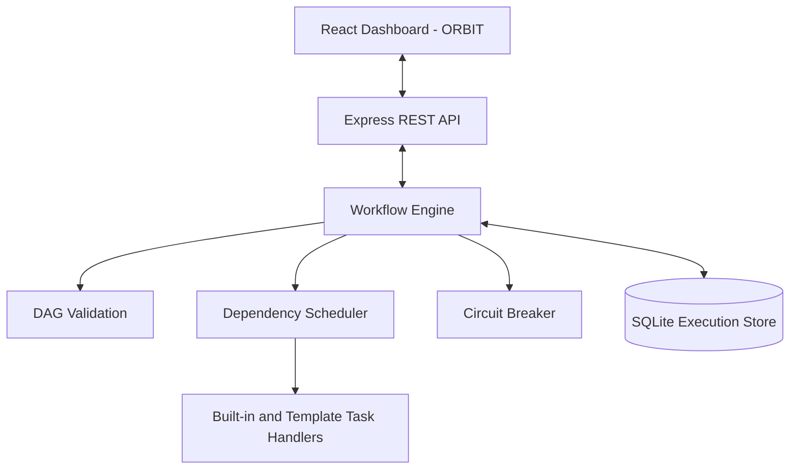

# Resilient DAG Orchestrator (ORBIT)

A local-first workflow orchestration application that executes predefined Directed Acyclic Graphs (DAGs), manages task dependencies, and demonstrates how a workflow can respond to failures and recover from interruptions.

The project combines a TypeScript orchestration engine, an Express REST API, SQLite persistence, and a React dashboard. The dashboard is branded **ORBIT** and provides a place to launch workflows, monitor executions, inspect task outputs, and review execution logs.

> **Project scope:** This version provides three backend-defined workflow templates. Users can select and configure the supported inputs and resilience parameters, but the interface does not provide a custom DAG editor or allow users to change task dependencies.

## Key Features

- **DAG validation:** checks workflow and task identifiers, dependencies, duplicate tasks, self-dependencies, invalid task options, and circular dependencies before execution.
- **Dependency-aware scheduling:** runs tasks only after their prerequisites have completed and applies a workflow-specific concurrency limit. The supplied CSV and text-analysis templates use a limit of 2; the resilience template uses a limit of 3. These limits are defined in the backend templates, not edited through the dashboard.
- **Failure handling:** supports retries with capped exponential backoff, task timeouts, cooperative cancellation through `AbortSignal`, and failure isolation between independent branches.
- **Circuit breaker:** demonstrates the `CLOSED`, `OPEN`, and `HALF_OPEN` states to protect a task that represents an external service.
- **Persistent execution history:** stores workflow definitions, execution and task states, attempt history, outputs, circuit-breaker snapshots, and logs in SQLite.
- **Restart recovery:** detects unfinished work when the backend starts again and resumes interrupted tasks while preserving completed task results.
- **Execution dashboard:** displays run statistics, recent executions, workflow templates, task-level status, attempt counts, outputs, and timestamped logs.

## Workflow Templates

### 1. CSV Data Processing Pipeline

A sample data pipeline that accepts an uploaded CSV file or uses `data/sample.csv`.

1. Read the CSV input.
2. Validate the required columns and row values.
3. Clean and normalize records and remove duplicate or unusable customer IDs.
4. Calculate record counts and amount statistics.
5. Export the processed data as a CSV file.

The expected columns are `customer_id`, `name`, `email`, `amount`, and `region`. Uploaded CSV files must be **512 KB or smaller**. A completed run provides a processed CSV download.

### 2. Resilience and Failure Recovery Pipeline

A demonstration workflow for testing task failures and recovery. Its main branch runs through data fetch, validation, processing, and report generation. A separate health-check branch starts independently, allowing the project to demonstrate how one branch can continue when another branch fails.

Available scenarios include:

- **No injected failure:** runs the workflow without a deliberate failure.
- **Temporary failure:** makes the first external-service attempt fail so the retry and circuit-breaker recovery path can be observed.
- **Permanent failure:** keeps the external-service task failing until its configured attempts are exhausted.
- **Slow task:** delays a task so its timeout behavior can be examined.
- **Independent branch failure:** fails the health-check branch while the report branch continues.

The template also supports a configurable random failure probability, maximum attempts, task timeout, and artificial delay. Execution logs show task attempts and circuit-breaker state changes. The external-service behavior is simulated: the task returns sample records and injects controlled failures; it does not call a real third-party service.

### 3. Text Analysis Pipeline

Accepts non-empty text of up to **100,000 characters**, validates it, and generates a report containing:

- Character and non-whitespace character counts.
- Word, sentence, and paragraph counts.
- Average sentence length.
- Frequently occurring keywords and topic terms.
- A short extractive summary based on sentence relevance.

## Technology Stack

| Layer | Technologies |
|---|---|
| Backend | Node.js, TypeScript, Express 5 |
| Workflow persistence | SQLite with `better-sqlite3` |
| Frontend | React 19, Vite 8, Lucide React |
| Testing | Vitest, Supertest, TypeScript test type-checking |
| Package management | npm |

## Architecture Overview



The frontend communicates with the backend through the `/api` routes; it does not connect directly to SQLite. The workflow engine validates each workflow, schedules eligible tasks, invokes their handlers, and records execution details in SQLite. The Express API exposes stored execution history and dashboard statistics to the frontend.

## Getting Started

### Prerequisites

- Node.js **20.19+ or 22.12+**.
- npm (included with Node.js).
- A modern web browser.

The Node.js requirement follows the Vite 8 compatibility requirement. See the [Vite Getting Started guide](https://vite.dev/guide/) for details.

### Install and Run on Windows

Open PowerShell in the project root directory (the directory containing `package.json`) and run:

```powershell
npm install
npm run build:app
npm test
npm start
```

After the server starts, open:

**http://127.0.0.1:3000**

`npm run build:app` compiles the TypeScript backend and builds the React frontend. `npm start` starts the Express server and serves the production frontend build when it is available.

### Run in Development Mode

Use two PowerShell terminals from the project root.

**Terminal 1 – Start the backend:**

```powershell
npm start
```

**Terminal 2 – Start the Vite frontend:**

```powershell
npm run dev
```

Open **http://127.0.0.1:5173**. The Vite development server forwards `/api` requests to the backend at `http://127.0.0.1:3000`.

## Configuration

The application supports the following environment variables:

| Variable | Default | Purpose |
|---|---|---|
| `PORT` | `3000` | Port used by the Express API server. |
| `DATABASE_PATH` | `./data/orchestrator.sqlite` | Location of the SQLite database file. |

Example PowerShell configuration:

```powershell
$env:PORT = "3000"
$env:DATABASE_PATH = "C:\path\to\orchestrator.sqlite"
npm start
```

The application creates the database directory automatically when the server starts.

## REST API

All API routes are served from the backend on port `3000` by default.

| Method | Endpoint | Description |
|---|---|---|
| `GET` | `/api/health` | Check API health. |
| `GET` | `/api/templates` | List available workflow templates. |
| `GET` | `/api/templates/:id` | Retrieve one workflow template. |
| `POST` | `/api/executions` | Start a workflow execution. |
| `GET` | `/api/executions` | List executions; supports `limit` and `offset`. |
| `GET` | `/api/executions/:id` | Retrieve execution details. |
| `GET` | `/api/executions/:id/tasks` | Retrieve task-level results. |
| `GET` | `/api/executions/:id/logs` | Retrieve execution logs. |
| `GET` | `/api/executions/:id/output` | Download the processed CSV for a completed CSV workflow. |
| `GET` | `/api/dashboard/stats` | Retrieve dashboard statistics and recent runs. |

Example request to start the resilience workflow:

```json
{
  "templateId": "resilience-recovery",
  "parameters": {
    "scenario": "temporary_failure",
    "failureProbability": 0,
    "maxAttempts": 3,
    "taskTimeoutMs": 1000,
    "artificialDelayMs": 0
  }
}
```

Send this body to `POST /api/executions`. The API responds with **`202 Accepted`** and an execution ID. For the CSV template, pass CSV text in `input.csvContent`; for the text-analysis template, pass text in `input.text`.

## Project Structure

```text
Resilient_DAG_Orchestrator/
├── data/
│   ├── exports/                # Generated CSV exports (may contain prior run outputs)
│   └── sample.csv              # Included sample input
├── dist/                       # Compiled backend JavaScript and declarations
├── frontend/
│   ├── index.html              # Vite HTML entry point
│   ├── vite.config.js          # Frontend development/build configuration
│   └── src/
│       ├── api.js              # Frontend API client
│       ├── App.jsx             # ORBIT dashboard and views
│       ├── main.jsx            # React entry point
│       └── styles.css          # Dashboard styles
├── frontend-dist/              # Production frontend build
├── src/
│   ├── app.ts                  # Express API routes and request validation
│   ├── builtins.ts             # Reusable task handlers
│   ├── circuit-breaker.ts      # Circuit-breaker state management
│   ├── csv.ts                  # CSV parsing and serialization
│   ├── dag.ts                  # DAG validation and topological sorting
│   ├── engine.ts               # Workflow scheduling and task execution
│   ├── index.ts                # Public module exports
│   ├── server.ts               # Server startup and shutdown
│   ├── store.ts                # SQLite persistence and recovery data
│   ├── templates.ts            # Workflow templates and task handlers
│   └── types.ts                # Shared workflow and execution types
├── tests/
│   ├── api.test.ts
│   ├── circuit-breaker.test.ts
│   ├── dag.test.ts
│   ├── engine.test.ts
│   └── recovery.test.ts
├── .gitignore
├── package-lock.json
├── package.json
├── README.md
├── tsconfig.json
└── tsconfig.test.json
```

`dist/` and `frontend-dist/` are generated by the build scripts. The SQLite database is created under `data/` by default.

## Validation and Test Commands

Run these commands from the project root:

```powershell
# Build the backend and frontend
npm run build:app

# Type-check the test files
npm run typecheck:tests

# Run the automated test suite
npm test

# Check installed dependencies for reported vulnerabilities
npm audit
```

The test suite includes coverage for API behavior, DAG validation, workflow execution, circuit-breaker behavior, retry handling, and SQLite restart recovery.

## Design Notes and Limitations

- **At-least-once recovery:** an interrupted task may run again after a restart. The engine preserves completed task results, but exactly-once execution is not guaranteed. Task handlers that cause external side effects should therefore be idempotent.
- **Cooperative timeouts:** task handlers receive an `AbortSignal`. A timeout or cancellation can request that a handler stop, but it cannot forcibly terminate arbitrary JavaScript work that ignores the signal.
- **Single-process circuit breakers:** breaker state is persisted for restart recovery, but the implementation is local to one backend process; it is not a distributed circuit breaker for multiple server instances.
- **Fixed workflow templates:** the current interface supports the three templates described above rather than user-authored DAGs or editable dependency graphs.

---

**Resilient DAG Orchestrator (ORBIT)** — SSD Micro Project
